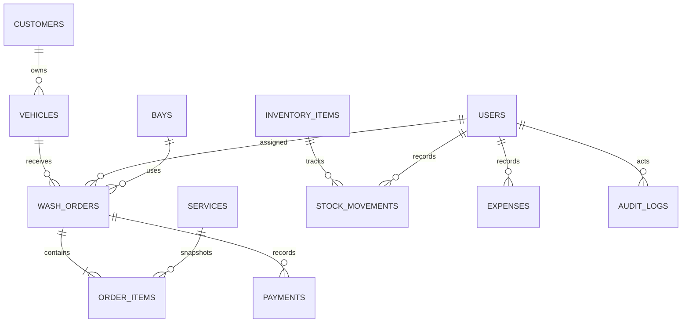

# Architecture and customization

## Stack and organization

Laravel 12, PHP 8.2+, Eloquent, MySQL 8/InnoDB, Blade, local CSS and vanilla JavaScript. Session-based authentication and framework CSRF protection apply to all browser mutations. No public registration exists. No external frontend build is required.

| Location | Responsibility |
|---|---|
| `routes/web.php` | HTTP routes, authentication and permission middleware |
| `routes/console.php` | Secure admin creation and local demo setup |
| `config/carwash.php` | Explicit management-module definitions and validation rules |
| `app/Models` | Customer, vehicle, order, service, payment and business entities |
| `app/Services/OrderService.php` | Transactional pricing, order transitions, payment/refund ledger |
| `app/Http/Controllers` | Request validation and application workflows |
| `app/Http/Middleware` | Security headers, active-account checks and business timezone |
| `app/Support/Audit.php` | Key action logging without passwords or payment credentials |
| `resources/views` | Layouts, screens, receipt and friendly error pages |
| `public/app.css`, `public/app.js` | Responsive design and progressive enhancements |
| `public/logo.svg` | Original replaceable sample logo |
| `database/migrations` | Versioned schema including indexes and foreign keys |
| `database/seeders` | Initial catalog/settings and optional fictional demo |
| `tests/Feature` | RBAC, business invariants and HTTP integration tests |
| `storage/app/private` | Validated logos and optional local demo access file |
| `docs` | Installation, manual, API, security and verification |

Management modules are resolved through an explicit configuration whitelist, not arbitrary model names from the URL. Server validation is always authoritative. Blade escaping protects displayed strings. Changing UI visibility alone never grants permission.

## Data relationships



Historical foreign keys restrict deletion. Customers and vehicles are live master records: correcting their names/plates is reflected in historical order displays. Service item names, prices, duration and financial totals are snapshots. Business contact information and logo on receipts reflect current Settings. If immutable invoice identity is required, extend order snapshots before formal invoicing use.

## Money and workflow rules

Monetary values use integer cents in storage. Two-decimal inputs are validated before conversion. Currency choices all use two decimal places. Service IDs are distinct and must still be active when the order is created. Tax is rounded once on the discounted subtotal. Client-submitted totals are ignored. Payment entries are signed amounts; refunds use negative values. A unique UUID protects a payment form from replay, and a replay with changed amount/order/method is rejected.

`OrderService` acquires an order row lock before checking balance or status. Starting a wash also locks bay and staff rows, then checks currently Washing orders. This serializes conflicting assignments on MySQL. Stock changes lock the inventory row before checking the resulting balance. Business writes and their audit entries share a transaction except password changes/sign-in audit events.

Valid transitions:

```text
scheduled -> waiting -> washing -> ready -> completed
scheduled -> cancelled
waiting   -> cancelled
```

Cancellation requires zero net collected. Completing requires no remaining balance. Ready releases resource occupancy. Refunds do not erase completion history or initiate real money transfers. Bookings are future arrival appointments without capacity reservation. There is no backward order transition; cancel/recreate unstarted orders when correction is needed.

## RBAC

`User::canDo` is the single role-to-permission map. Gates are registered in `AppServiceProvider`; routes and management controllers enforce them. Wash team order access is also restricted by assignment in both detail and status handlers. Add a permission to the map, define its Gate, protect the route/handler, then expose the UI. Add tests for both permitted and forbidden roles.

## Time and branding

The application stores business-local timestamps. Web middleware applies Settings.timezone; the default CLI timezone comes from APP_TIMEZONE. Keep APP_TIMEZONE aligned with the configured business timezone for future console jobs/imports. The demo seeder applies the business timezone explicitly. Currency/timezone cannot change after orders or expenses exist. For a multi-region or multi-branch extension, migrate timestamps to UTC and add explicit per-branch timezones rather than removing this guard.

UI branding uses the Settings row. Uploads are decoded by GD and re-encoded as PNG under randomized names in private storage. The rate-limited public `/branding/logo` route serves only the current business logo, including on the sign-in screen. SVG/HTML uploads are rejected. The static sample SVG is project-controlled source.

## Styling and performance

Colors, spacing and radii are CSS variables in `public/app.css`. Screens share `layouts/app.blade.php`; icons are a local Blade SVG component. Local system fonts avoid network dependencies. JavaScript adds estimate updates, print, menu toggling, confirmation prompts and temporary submit-button disabling; core forms work without JavaScript.

Lists are paginated and order relationships are eager-loaded. Dashboard results are bounded; reports group collections in SQL, and outstanding balances use an aggregate join. Vehicle/customer pickers currently load the business’s master list: introduce a paginated search picker before using very large customer/vehicle datasets. No production-scale benchmark or concurrency load test has been performed.

## Adding features

For a simple master record, add a migration/model and explicit module configuration with permitted fields, validation and permission. For workflows involving money, resource allocation or stock, add a dedicated service with transactions and invariants. Do not place accounting logic in Blade or JavaScript. Retain historical financial entries, use reversals for money, and document any new data-retention requirements.

## Verification commands

```powershell
php artisan test --compact
php vendor/phpunit/phpunit/phpunit -c phpunit.mysql.xml --testdox
composer validate --no-check-publish
composer audit --locked
php artisan view:cache
php artisan route:list --except-vendor
```

The MySQL test database must end in `_test`. TestCase refuses to boot against a business database. Keep `.env`, private uploads, local access credentials and vendor/runtime output out of source control. Composer dependencies are pinned in `composer.lock`; use `composer install` on another machine.
